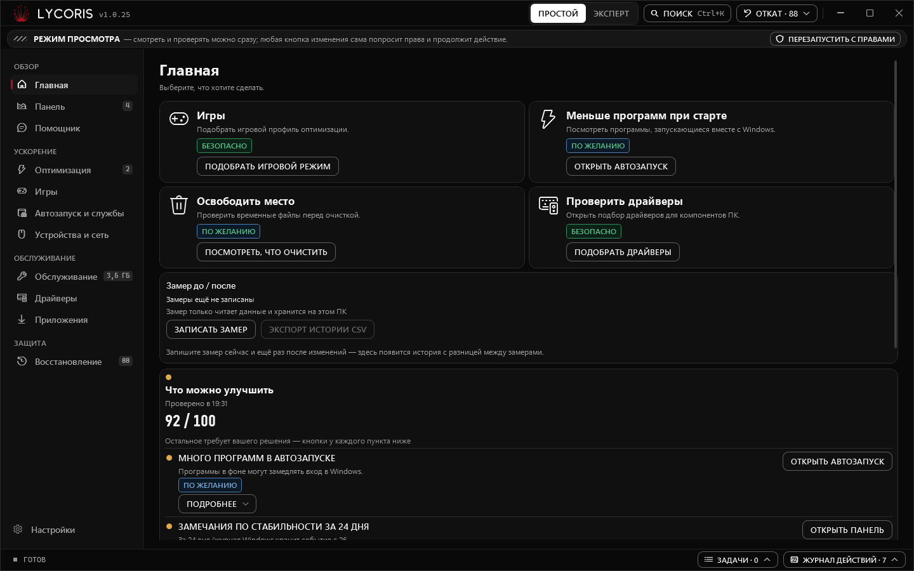
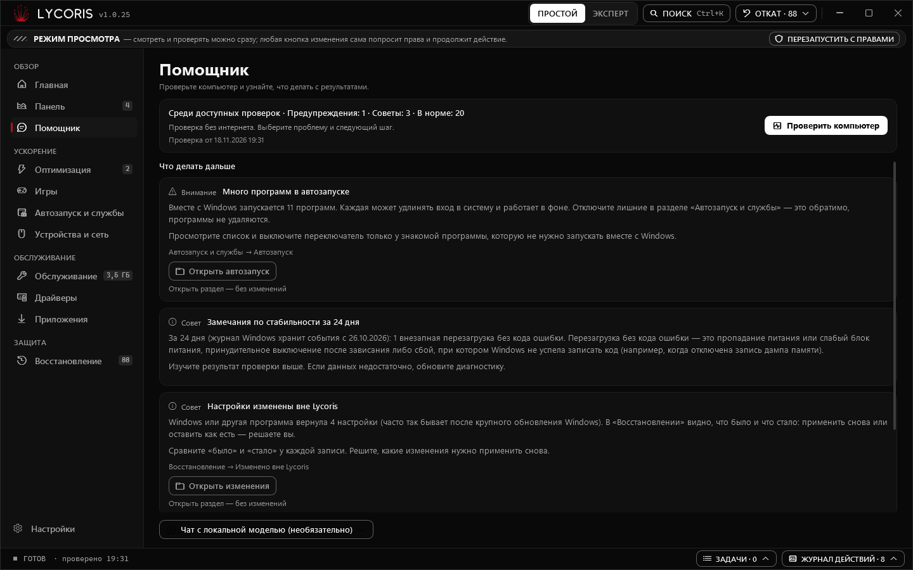
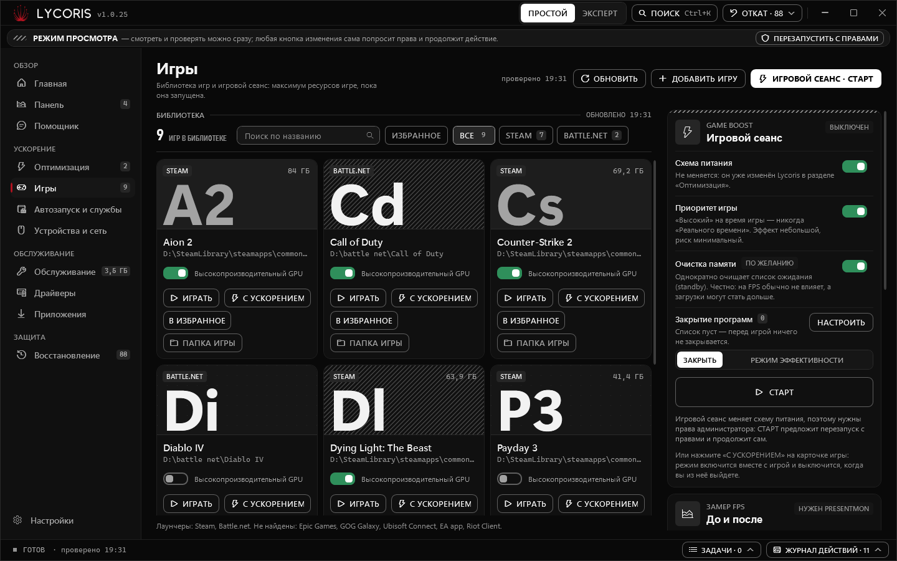

  

**Lycoris помогает понять состояние Windows, найти проблемы и обслуживать ПК.** Нагрузка и состояние системы, понятные рекомендации, инструменты для работы и игр — в одном приложении.

**[Скачать установщик или portable](https://github.com/bil-xvii/Lycoris-releases/releases/latest)** · [Portable одним файлом — Lycoris.exe](https://github.com/bil-xvii/Lycoris-releases/releases/latest/download/Lycoris.exe)

Windows 10 2004+ / Windows 11, x64. .NET включён в загрузку. Интерфейс на русском и английском.

## Возможности

- **Состояние ПК.** Мониторинг CPU, GPU, RAM, дисков и сети; диагностика проблем с оборудованием и настройками Windows.
- **Помощник.** Объясняет найденные проблемы, открывает нужный раздел и может применить поддерживаемые исправления. Базовые подсказки работают без локальной AI-модели; для свободных вопросов можно подключить локальный чат через Ollama.
- **Игры.** Библиотека и избранное, запуск с GameBoost и профили оптимизации под разные задачи.
- **Автозапуск и службы.** Просмотр фоновых программ и управление поддерживаемыми настройками.
- **Обслуживание.** Анализ и очистка временных файлов, системные инструменты и проверка драйверов.
- **Контроль изменений.** Предпросмотр, подтверждение действий с правами администратора, журнал и откат поддерживаемых настроек.

## Как выглядит

**Главная — состояние системы и ближайшие действия.**

Помощник и игровая библиотека

**Помощник — объяснения проблем и доступные действия.**

**Игры — библиотека, избранное и GameBoost.**

Скриншоты версии **1.0.25**. Показатели и рекомендации зависят от компьютера.

## Перед запуском

Простой режим доступен всем. Экспертный режим пока доступен только автору на его ПК. Просмотр и диагностика работают без прав администратора; действия, требующие повышения прав, подтверждаются.

Откат предусмотрен для поддерживаемых настроек. Очистка файлов необратима; не каждое изменение можно отменить. Создание точки восстановления зависит от доступности и включённой защиты системы Windows. Результат оптимизации зависит от ПК и задачи — гарантий прироста FPS нет.

У приложения пока нет сертификата Authenticode: Windows может показывать неизвестного издателя. Сверяйте SHA-256 с файлом из релиза. Проверка подписи обновлений ECDSA — отдельный механизм и не заменяет подпись издателя Windows.

## English

**Lycoris brings Windows diagnostics, maintenance and gaming tools into one app.** Monitor CPU, GPU, RAM, disks and network; understand detected issues with the Assistant; manage games, GameBoost, optimization profiles, startup, services, cleanup and drivers. Basic guidance works without a local AI model; optional Ollama chat supports open-ended questions.

**[Download installer or portable](https://github.com/bil-xvii/Lycoris-releases/releases/latest)** · [Portable EXE](https://github.com/bil-xvii/Lycoris-releases/releases/latest/download/Lycoris.exe)

Windows 10 2004+ / Windows 11 x64; .NET included; RU/EN interface. Simple mode is available to everyone; Expert mode is currently limited to the author's PC. Review and confirm changes requiring administrator rights. Only supported settings can be rolled back; cleanup is irreversible. Restore points require available and enabled Windows System Protection. Performance gains are not guaranteed.

Screenshots show the real **1.0.25** release on a specific PC. The app has no Authenticode certificate yet, so Windows may show “Unknown publisher”. Verify the release SHA-256; ECDSA update verification is separate from Windows publisher signing.

[Исходный код / Source](https://github.com/bil-xvii/Lycoris) · [Лицензия / License](LICENSE.md)
