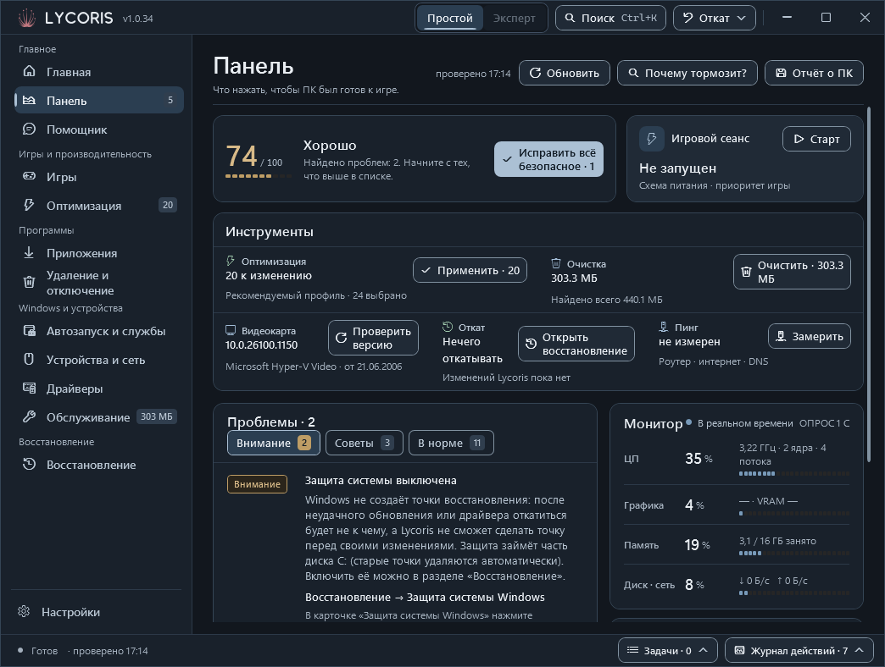
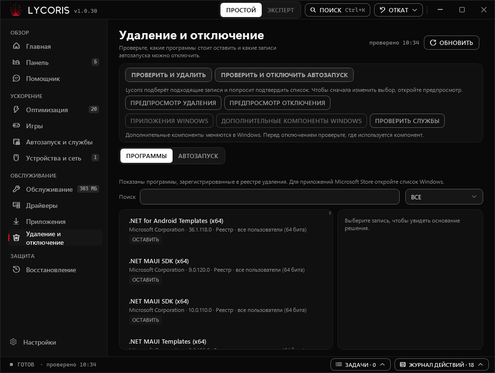

  

**Lycoris — диагностика, обслуживание и настройка Windows под игры, работу и другие задачи.** Определяет тип ПК, объясняет найденные проблемы и предлагает изменения по подтверждённым данным.

**[Скачать установщик или portable](https://github.com/bil-xvii/Lycoris-releases/releases/latest)** · [Portable одним файлом — Lycoris.exe](https://github.com/bil-xvii/Lycoris-releases/releases/latest/download/Lycoris.exe)

Windows 10 2004+ / Windows 11, x64. .NET включён в загрузку. Интерфейс на русском и английском.

## Возможности

- **Состояние и тип ПК.** Мониторинг CPU, GPU, RAM, дисков и сети. Тип компьютера определяется по SMBIOS и данным корпуса; неизвестные и противоречивые сведения указаны явно.
- **Советы с действием в 1.0.32.** Панель показывает точный путь, следующий шаг и кнопку открытия нужного раздела Lycoris или Windows. Поддерживаемое исправление подтверждается и проверяется повторно; неизвестная причина сбоя направляет к журналу надёжности.
- **Помощник.** Объясняет найденные проблемы и применяет поддерживаемые исправления. Без Ollama понимает «включи», «отключи», «запусти» и «останови службу…»: показывает точную цель и последствия, проверяет разрешения и результат. Для свободных вопросов доступен локальный чат через Ollama.
- **Программы и драйверы.** Рекомендации по подтверждённой потребности: например, игровые службы для обнаруженного Xbox. Ошибка сканирования или старый кэш не считаются отсутствием программы; ручной выбор сохранён.
- **Игры и профили.** Библиотека, избранное и GameBoost. Профили для игр, работы, стриминга и свой набор учитывают подтверждённую применимость аппаратных настроек.
- **Обслуживание.** Автозапуск и службы, анализ и очистка временных файлов, системные инструменты.
- **Удаление и отключение.** «Проверить и удалить» и «Проверить и отключить автозапуск» запускают проверку, подбирают подходящие позиции и выполняют действие после подтверждения точного списка. В отдельном предпросмотре можно исключить позиции до подтверждения. Lycoris учитывает данные установки, цифровые подписи и связи с системой. Системные компоненты и записи с неподтверждёнными данными остаются вне автоматического выбора. Пакетное удаление запускает штатный деинсталлятор через WinGet 1.8.1791 или новее. Деинсталлятор может спросить, какие данные сохранить. Удаление программы необратимо в Lycoris. Отключение автозапуска сохраняет файлы и допускает откат.
- **Приложения Store.** Отдельный список позволяет явно выбрать удаляемые приложения текущего пользователя. Перед удалением повторно проверяются регистрация и зависимости. Xbox, Game Bar, игровые службы, античит и системная инфраструктура защищены от автоматического удаления или отключения.
- **Разбор служб.** Возможные будущие функции сохраняются через обратимую настройку запуска. Удаление остатков ограничено проверенными сценариями: сейчас только простой остаток Everything после подтверждения удаления программы; неизвестные службы не удаляются автоматически.
- **Контроль изменений.** Проверка ПК без изменений системы, предпросмотр и повторная проверка плана перед установкой. Подтверждение действий с правами администратора, журнал и откат поддерживаемых настроек.
- **Актуальные сведения.** Открытые списки программ, служб и автозапуска обновляются при возвращении в окно и по интервалу, когда нет игры или другой операции. Поиск новых версий продолжается при работе в трее; установка подтверждается и проверяет подпись релиза.

## Разовое закрытие программ в 1.0.33

Откройте **Игры → Игровой сеанс → Закрытие программ → Настроить**. Отметьте запущенные программы или добавьте их по имени, затем нажмите **Закрыть выбранные сейчас**. В предпросмотре указаны PID, полный путь к исполняемому файлу и время запуска в UTC для каждого процесса. После подтверждения Lycoris сначала отправляет обычный запрос на закрытие окна. Принудительное завершение оставшихся процессов требует отдельного подтверждения.

Кнопка выполняет только разовое закрытие выбранных вами программ. Схема питания, приоритет игры и очистка списка ожидания памяти относятся к настройкам игрового сеанса. Кнопка **Сохранить** отдельно обновляет список для будущих сеансов. Зарегистрированные игры, защищённые компоненты Windows и защищённые инструменты разработки исключены из закрытия. Итог показывает, сколько процессов действительно завершилось. Эффект на FPS и расход памяти зависит от ПК и выбранных программ.

В командной строке вызов `Lycoris.exe --close-background-apps <имена>` с именами через запятую выводит JSON предпросмотра и 64-символьный отпечаток точного плана в поле `plan`. Для выполнения повторите список в консоли с правами администратора и передайте `--yes --plan <отпечаток>`. Чтобы разрешить принудительное завершение после обычного закрытия окна, добавьте `--force` в обе команды. При изменении набора процессов сформируйте новый план.

## Как выглядит

**Главная — состояние системы и ближайшие действия.**

**Панель — путь, следующий шаг и открытие нужного раздела.**

Удаление, помощник, приложения и игровая библиотека

**Удаление и отключение — проверка, подтверждение списка и отдельный предпросмотр.**

**Помощник — объяснения проблем и доступные действия.**

**Приложения — рекомендации по подтверждённой потребности.**

**Игры — библиотека, избранное и GameBoost.**

Советы панели показаны в **1.0.32** в одноразовой среде Windows CI, помощник — в **1.0.32** с демонстрационным диалогом, удаление — в **1.0.30** в тестовой среде Windows, остальные скриншоты — из **1.0.26**. Показатели и рекомендации зависят от компьютера.

## Перед запуском

Простой режим доступен всем. Экспертный режим пока доступен только автору на его ПК. Просмотр и диагностика работают без прав администратора; действия, требующие повышения прав, подтверждаются.

Откат предусмотрен для поддерживаемых настроек. Очистка файлов необратима; не каждое изменение можно отменить. Создание точки восстановления зависит от доступности и включённой защиты системы Windows. Результат оптимизации зависит от ПК и задачи — гарантий прироста FPS нет.

У приложения пока нет сертификата Authenticode: Windows может показывать неизвестного издателя. Сверяйте SHA-256 с файлом из релиза. Проверка подписи обновлений ECDSA — отдельный механизм и не заменяет подпись издателя Windows.

## English

**Lycoris brings Windows diagnostics, maintenance and settings for gaming, work and other tasks into one app.** Monitor hardware and identify the PC type from SMBIOS and chassis data, with unknown or conflicting facts stated explicitly. App recommendations require a confirmed need; failed scans and cached data do not prove a program is missing. Gaming, work, streaming and custom profiles respect verified hardware applicability. Review the plan before changes; installation plans are checked again. Manage games, GameBoost, startup, services and cleanup. Basic Assistant guidance works without a local AI model; Ollama chat is optional.

**[Download installer or portable](https://github.com/bil-xvii/Lycoris-releases/releases/latest)** · [Portable EXE](https://github.com/bil-xvii/Lycoris-releases/releases/latest/download/Lycoris.exe)

The Assistant also handles explicit enable, disable, start and stop service requests without Ollama, with an exact plan and verified outcome. Start policy and current running state are separate. Service residue removal currently supports only a constrained Everything remnant after you confirm the program was uninstalled; unknown services are not deleted. Supported removal records can be restored disabled, including from Simple mode.

**Check and uninstall** and **Check and disable startup entries** run a fresh scan, select eligible entries and apply the action after you confirm the exact list. Use the separate preview buttons to exclude entries before confirming. The **Remove & disable** panel uses installation records, digital signatures and system integrations to assess eligibility. System components and entries with unverified details stay out of automatic selection. Batch uninstall uses each app's registered uninstaller through WinGet 1.8.1791 or later. The uninstaller may ask which data to keep. Uninstalling is irreversible in Lycoris. Disabling startup entries preserves their files and can be undone. Selected current-user Store applications can be removed after fresh identity and dependency checks. Xbox and Game Bar infrastructure remain protected.

In **1.0.32**, Dashboard advice includes the exact destination, next step and an Open button. Supported fixes require confirmation and a fresh result check. Visible software and service lists refresh when idle, and release checks continue during long tray sessions. Update installation remains confirmed and signature-verified.

Gaming and streaming presets use an applicable Balanced plan, preserving compatible OEM plans. Automatic disk cleanup and other settings with trade-offs remain individual choices.

Windows 10 2004+ / Windows 11 x64; .NET included; RU/EN interface. Simple mode is available to everyone; Expert mode is currently limited to the author's PC. Review and confirm changes requiring administrator rights. Only supported settings can be rolled back; file cleanup is irreversible. Restore points require available and enabled Windows System Protection. Performance gains are not guaranteed.

Dashboard advice shows **1.0.32** in a disposable Windows CI environment; Assistant shows **1.0.32** with a demo conversation. The removal panel shows **1.0.30** in a Windows test environment; the remaining screenshots show **1.0.26**. The app has no Authenticode certificate yet, so Windows may show “Unknown publisher”. Verify the release SHA-256; ECDSA update verification is separate from Windows publisher signing.

### Close selected programs once in 1.0.33

Open **Games → Game session → Closing programs → Set up**. Select running programs or add them by name, then click **Close selected now**. The preview shows each process ID (PID), full executable path and UTC start time. After confirmation, Lycoris first sends a normal window-close request. Forced termination of remaining processes requires separate confirmation.

This action closes only eligible programs you select. The power plan, game priority and standby memory cleanup are game session settings. Use **Save** separately to update the list for future sessions. Registered games, protected Windows components and protected development tools are excluded from closure. The result reports how many processes actually exited. The effect on FPS and memory use depends on the PC and the selected programs.

On the command line, `Lycoris.exe --close-background-apps <names>` takes comma-separated names and returns a JSON preview with a 64-character fingerprint of the exact plan in the `plan` field. To run the plan, repeat the list in an administrator terminal and pass `--yes --plan <fingerprint>`. Add `--force` to both commands to allow forced termination after normal window closure. Generate a fresh plan if the set of processes changes.

[Исходный код / Source](https://github.com/bil-xvii/Lycoris) · [Лицензия / License](LICENSE.md)
